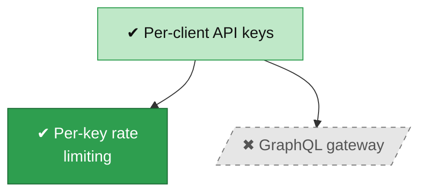

<!-- Generated by build.py from nodes.yaml. Do not edit. -->

# api - API

Scope: public HTTP API: endpoints, auth, rate limits, versioning.

[Back to the page](../../roadmap.md) · [legend](../../roadmap.md#legend)

<!-- BEGIN GENERATED: track-api -->

<!-- END GENERATED: track-api -->

## Node table

<!-- BEGIN GENERATED: table-api -->
| id | title | state | outcome | headline | evidence | depends_on |
|---|---|---|---|---|---|---|
| `api-auth-keys` | Per-client API keys | done | successful |  | PR #101 |  |
| `api-rate-limit` | Per-key rate limiting | done | very-successful | p99 410 ms -> 180 ms | PR #212; docs/adr/0007-rate-limits.md | api-auth-keys |
| `api-graphql-gateway` | GraphQL gateway | abandoned | dead-end |  | notes/graphql-spike.md | api-auth-keys |

### Details per node

| id | title | verdict | headline | in plain words | notes | evidence |
|---|---|---|---|---|---|---|
| `api-auth-keys` | Per-client API keys | Merged; all endpoints now require a key. |  | Every client gets its own key, so we can tell who calls what. |  | PR #101 |
| `api-rate-limit` | Per-key rate limiting | Merged; p99 latency unchanged under the load test. | p99 410 ms -> 180 ms | Each API key gets its own request budget, so one noisy client cannot slow the rest. |  | PR #212; docs/adr/0007-rate-limits.md |
| `api-graphql-gateway` | GraphQL gateway | Dropped: query cost limits needed more work than the clients gain. |  |  |  | notes/graphql-spike.md |

### Folded items per node

- `api-rate-limit`: Per-key rate limiting
  - Retry-After header (2026-02-05, commit 3f9c2a1b)
  - Fix limiter test flake
- `api-graphql-gateway`: GraphQL gateway
  - Schema stitching prototype (2026-02-20, session record)
<!-- END GENERATED: table-api -->
