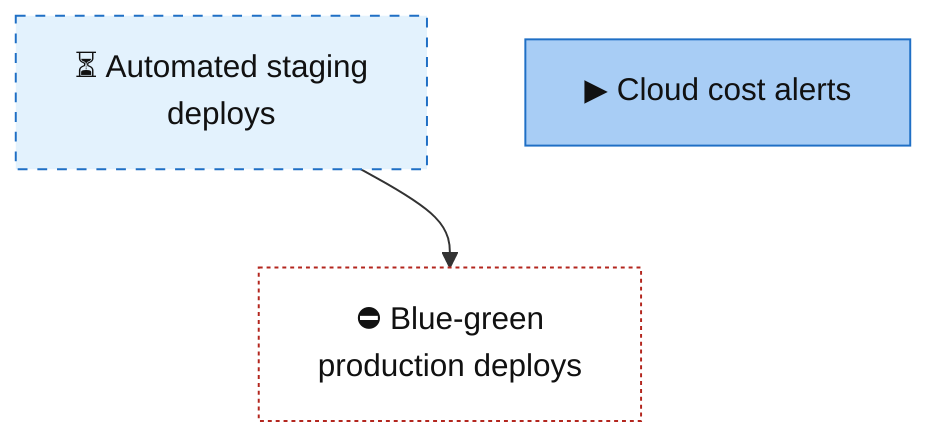

<!-- Generated by build.py from nodes.yaml. Do not edit. -->

# ops - operations

Scope: CI, deploys, monitoring, cost.

[Back to the page](../../roadmap.md) · [legend](../../roadmap.md#legend)

<!-- BEGIN GENERATED: track-ops -->

<!-- END GENERATED: track-ops -->

## Node table

<!-- BEGIN GENERATED: table-ops -->
| id | title | state | outcome | headline | evidence | depends_on |
|---|---|---|---|---|---|---|
| `ops-staging-deploy` | Automated staging deploys | in-progress | unrated |  |  |  |
| `ops-blue-green` | Blue-green production deploys | blocked | unrated |  |  | ops-staging-deploy |
| `ops-cost-alerts` | Cloud cost alerts | in-progress | unrated |  |  |  |

### Details per node

| id | title | verdict | headline | in plain words | notes | evidence |
|---|---|---|---|---|---|---|
| `ops-staging-deploy` | Automated staging deploys |  |  | Pushing to the main branch updates the staging site by itself. |  |  |
| `ops-blue-green` | Blue-green production deploys |  |  | Switch production traffic between two copies so a bad deploy can be undone at once. |  |  |
| `ops-cost-alerts` | Cloud cost alerts |  |  | Email when the monthly cloud bill passes a set limit. |  |  |
<!-- END GENERATED: table-ops -->
